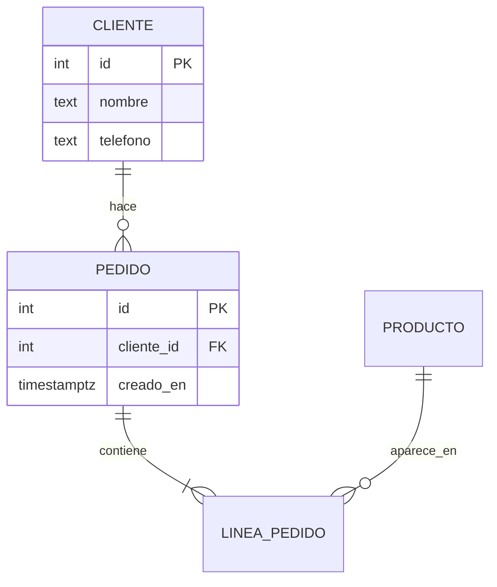

# PRD · <Bolsa de Empleo Estudiantil>

> Documento de requisitos del producto (Product Requirements Document).
> Complétalo en el Sprint 0 (historia H0.3) y pide la aprobación del profesor en un Issue.
> Cada requisito funcional (RF) se convierte en un Issue con la plantilla "Historia de usuario".

| Campo | Valor |
| --- | --- |
| Alumno | Meyker Josue Guaripaca Gonzalez |
| Proyecto n.º | Bolsa de Empleo Estudiantil |
| Sitio de referencia |Computrabajo |
| Compañero revisor |Jaison Pernía |
| URL desplegada | (se completa en el Sprint 5) |

## 1. Problema

Los estudiantes universitarios tienen dificultades para encontrar vacantes y pasantías alineadas con sus habilidades y etapa académica, mientras que las empresas y reclutadores invierten mucho tiempo filtrando candidatos sin un criterio claro de afinidad con los requisitos del puesto.

## 2. Usuarios

- **Usuario principal:** Estudiante universitario que busca pasantías o empleos acordes a sus habilidades y revisa vacantes ordenadas por afinidad, accediendo desde computadora o teléfono móvil.
- **Usuario secundario:**Empresa o reclutador que publica ofertas, define las habilidades requeridas y revisa candidatos postulados, además de administración para gestionar el catálogo.

## 3. Objetivo y métrica de éxito

Un estudiante visualiza y ordena las vacantes compatibles con sus habilidades en menos de 5 segundos y envía una postulación en menos de 1 minuto.

## 4. Alcance del MVP

1. Registro e inicio de sesión con roles (estudiante, empresa/reclutador, administrador).
2. Perfil estudiantil con registro de habilidades y disponibilidad.
3. Publicación, consulta y filtrado de vacantes y pasantías.
4. Ranking de vacantes por coincidencia de habilidades (*skills matching*).
5. Postulación a vacantes y seguimiento del estado de postulaciones.

### Funcionalidades → carpetas de `src/` (screaming architecture)

Cada funcionalidad del alcance será una carpeta en `src/`. Nómbralas en inglés y en plural.

| Funcionalidad | Carpeta |
| --- | --- |
| Autenticacion y roles | `src/auht` |
| Perfiles y habilidades de estudiantes|`src/students/` |
| Vacantes y pasantías | `src/vacancies/` |
| Ranking por coincidencia de habilidades | `src/matchings/` |
| Postulaciones | `src/applications/` |

## 5. Fuera de alcance

1. Clon ni copia de Computrabajo
2. pantallas de pago

-

## 6. Requisitos funcionales

| ID | Requisito | Prioridad (alta, media, baja) |
| --- | --- | --- |
| RF-01 |Registrar y autenticar usuarios según su rol (estudiante, empresa/reclutador, administrador)alta|
| RF-02 |Crear y editar perfil estudiantil con carrera, disponibilidad y habilidades | alta |
| RF-03 |Publicar, listar y filtrar vacantes o pasantías con habilidades requeridas | alta |
| RF-04 |Calcular y ordenar el ranking de vacantes por coincidencia de habilidades | alta |

## 7. Requisitos no funcionales

- Responsive, móvil primero (375 px y 1280 px).
- Lighthouse ≥ 90 en Accesibilidad y Buenas prácticas.
- 0 errores en la consola del navegador.
- Funciona con 10.000 registros sin congelarse.

## 8. Modelo de datos

Diagrama entidad-relación y tablas PostgreSQL con tipos, claves y restricciones.
GitHub dibuja diagramas Mermaid; edita este ejemplo:

## 9. Reto técnico distintivo

Ordenar el ranking de vacantes por coincidencia de habilidades entre el perfil del estudiante y los requisitos de cada vacante.

## 10. Riesgos y preguntas abiertas

Empates en el raking 
Que la BD se vuelva lenta cuando haya muchos registros

¿Cómo se diferenciarán las vacantes o pasantías dirigidas a estudiantes frente a ofertas generales como las de Computrabajo?

¿Qué estados tendrá una postulación (por ejemplo: enviada, en revisión, aceptada o rechazada)?